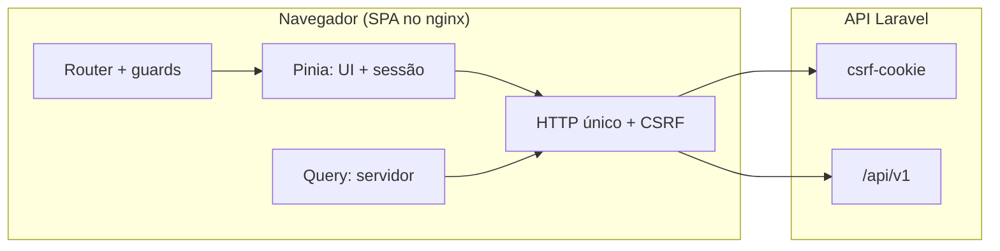

# starter-kit-frontend

SPA administrativa em Vue 3 + Quasar que consome a API do Starter Kit por sessão cookie com proteção CSRF. Pinia guarda só interface e sessão em memória, TanStack Query gerencia todo o estado de servidor, e um único cliente HTTP central detém credenciais, fluxo CSRF e erros tipados. Tipos e hooks de API são gerados pelo Orval a partir do contrato OpenAPI pinado em `openapi/` — nada de endpoint escrito à mão.

## Stack

| Camada                | Tecnologia                 | Versão           |
| --------------------- | -------------------------- | ---------------- |
| Framework UI          | Vue                        | 3.5.43           |
| Componentes e estilo  | Quasar                     | 2.34.0           |
| Build e dev server    | Vite                       | 8.3.2            |
| Linguagem             | TypeScript estrito         | 6.0.3            |
| Runtime / pacote      | Node.js / npm              | 24.15.0 / 12.2.0 |
| Estado de UI e sessão | Pinia                      | 4.0.3            |
| Estado de servidor    | TanStack Vue Query         | 5.104.1          |
| Rotas                 | Vue Router                 | 5.3.1            |
| Transporte HTTP       | axios                      | 1.20.0           |
| Cliente gerado        | Orval                      | 8.39.0           |
| Testes                | Vitest + jsdom + MSW       | 5.0.3 / 3.0.2    |
| Lint / formato        | ESLint flat / Prettier     | 10.12.0 / 3.9.9  |
| Produção              | nginx alpine / node alpine | 1.29 / 26        |

## Documentação

Guia numerado, do zero ao deploy. Referência complementar: `smoke-checklist.md`, `deployment-preview-rollback.md`, `adr/`.

- [`docs/01-instalacao.md`](docs/01-instalacao.md)
  Pré-requisitos de Node/npm travados por `engines` e `.nvmrc`, criação do `.env` a partir do exemplo certo e como apontar a SPA para a API local com CORS e Sanctum.
- [`docs/02-comandos.md`](docs/02-comandos.md)
  Cada script do `package.json` explicado por dentro — `dev`, `build`, `client:generate`, `client:check`, `test`, `test:coverage`, `typecheck`, `lint`, `format`, `preview`, `smoke:browser` — com quando usar e saída esperada.
- [`docs/03-arquitetura.md`](docs/03-arquitetura.md)
  Mapa das pastas por funcionalidade, divisão Pinia vs TanStack Query, mutador Orval, guards do router com tabela de rotas 401/403 e os seis estados da sessão incluindo a limitada.
- [`docs/04-decisoes.md`](docs/04-decisoes.md)
  Cada decisão com motivo e alternativa rejeitada: Query para servidor, MSW, Orval pinado, alias `@/`, arrow functions, sem comentários, testes em inglês com mensagens pt-BR, thresholds de cobertura, nginx com fallback SPA e E2E fora do repo.
- [`docs/05-integracao-fullstack.md`](docs/05-integracao-fullstack.md)
  Sequência SPA→API com `withCredentials` e `csrf-cookie`, `VITE_API_URL` por ambiente, procedimento quando o contrato OpenAPI muda e tabela de endpoints consumidos com guards.



## Início rápido

```sh
cp .env.development.example .env
npm ci
npm run dev
```

Detalhes e solução de problemas de CORS em [`docs/01-instalacao.md`](docs/01-instalacao.md). Validação completa antes de entregar:

```sh
npm run format:check && npm run lint && npm run typecheck && npm test && npm run build
```

O que cada comando faz está em [`docs/02-comandos.md`](docs/02-comandos.md).
