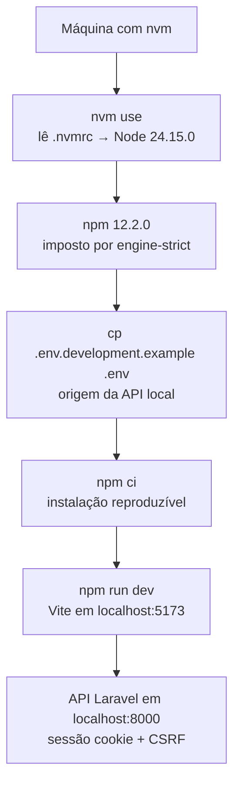
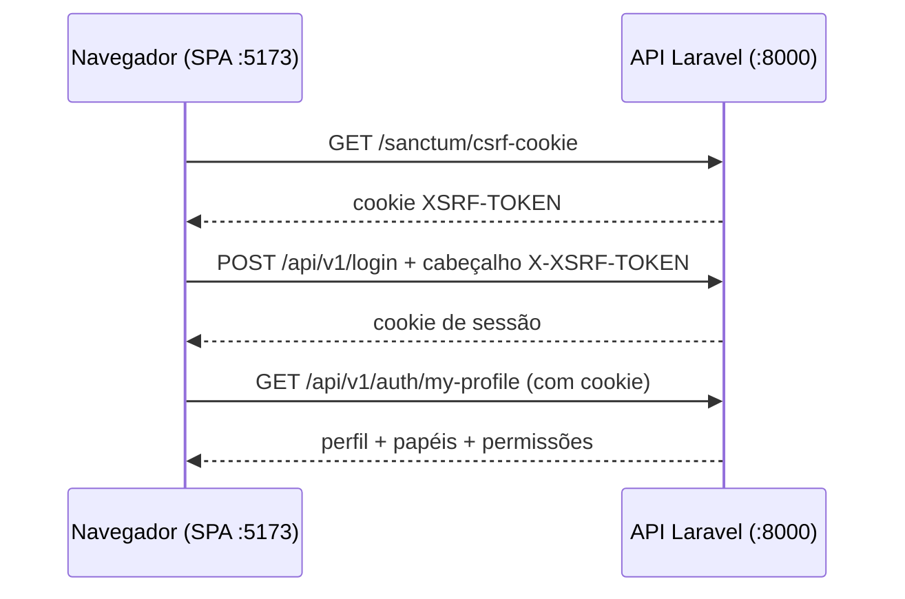

# 01 — Instalação e ambiente local

Este guia leva uma máquina vazia até a SPA rodando contra a API local. Cada comando tem o motivo explicado; nada aqui é ritual sem propósito.

## Pré-requisitos

| Requisito | Versão exigida | Onde está travado |
|---|---|---|
| Node.js | `>= 24.15.0 < 25` (fixado em `24.15.0` pelo `.nvmrc`) | `engines` no `package.json`, `.nvmrc` |
| npm | `12.2.0` exato | `engines` no `package.json`, `.npmrc` com `engine-strict` |

O `.npmrc` ainda define `save-exact=true`, então qualquer `npm install <pacote>` grava a versão exata, sem intervalo. Com `engine-strict=true`, o npm recusa instalar se o Node ou o npm estiverem fora da faixa — o erro aparece cedo, em vez de uma quebra estranha no build.

Com o `nvm` instalado, o Node certo é ativado assim:

```sh
nvm use
node --version
npm --version
```

O `nvm use` lê o `.nvmrc` e troca para o Node `24.15.0`. Os dois comandos seguintes confirmam que as versões ativas batem com o `engines`. Saída esperada: `v24.15.0` e `12.2.0`.



## Clonar e entrar no projeto

```sh
git clone <url-do-repositorio> starter-kit-frontend
cd starter-kit-frontend
nvm use
```

O clone traz tudo, inclusive os exemplos de ambiente versionados (`.env.*.example`) e o contrato OpenAPI pinado em `openapi/`. O `.env` real nunca é versionado — está no `.gitignore` — então o passo seguinte é criá-lo a partir do exemplo certo.

## Criar o `.env` a partir do exemplo correto

Existem quatro exemplos versionados, um por ambiente. Para desenvolvimento local, o ponto de partida é sempre o de desenvolvimento:

```sh
cp .env.development.example .env
```

O conteúdo copiado é:

```sh
VITE_APP_ENV=development
VITE_API_URL=http://localhost:8000
```

Por que este arquivo e não outro:

| Arquivo de exemplo | Quando copiar para `.env` |
|---|---|
| `.env.development.example` | Desenvolvimento local — é este o caso agora |
| `.env.preview.example` | Nunca localmente; usado pelo CI de antevisão de PR |
| `.env.staging.example` | Referência para QA; aponta para a API de homologação |
| `.env.production.example` | Referência para release; aponta para a API de produção |

A única variável obrigatória é `VITE_API_URL`, sempre a origem raiz da API, sem caminho, sem query e sem barra final. Os caminhos `/api/v1/...` já vêm do contrato, então colocar caminho aqui quebraria todas as URLs. A validação é estrita e falha fechada: protocolo diferente de `http`/`https`, credencial embutida, query string ou fragmento fazem a criação do cliente HTTP lançar erro antes de qualquer pedido à rede.

## Instalar as dependências

```sh
npm ci
```

O `npm ci` instala exatamente o que está travado no `package-lock.json`, apagando `node_modules` antes. É o comando do CI e deve ser o local também: ele garante que a sua máquina tem as mesmas árvores de dependências que a esteira validou. Use `npm install` apenas quando quiser adicionar ou atualizar um pacote — nunca para uma instalação limpa.

## Subir o servidor de desenvolvimento

```sh
npm run dev
```

O `dev` executa `vite` puro, sem verificação de tipos e sem verificação de contrato — é propositalmente rápido. A aplicação fica disponível no endereço padrão do Vite, `http://localhost:5173`. Alterações em `src/` recarregam a quente no navegador.

## Apontar para a API local

Com o `.env` de desenvolvimento, a SPA em `http://localhost:5173` fala com a API em `http://localhost:8000`, em outra origem. Isso funciona porque a integração é por cookie com credenciais, e exige contrapartida na API:

- A origem `http://localhost:5173` precisa estar nas origens permitidas de CORS da API.
- A mesma origem precisa constar nos domínios stateful do Sanctum da API, senão o navegador bloqueia o cookie de sessão.



Se o login falhar com erro de rede ou CORS no dev, o primeiro lugar a olhar é o `VITE_API_URL` no `.env` e o registro da origem `:5173` na API — não o código da SPA. Detalhes do fluxo CSRF e da troca de cookies estão em `05-integracao-fullstack.md`.

## Validar a instalação completa

Depois do `dev` abrir sem erro, valide a cadeia inteira, nesta ordem:

```sh
npm run format:check
npm run lint
npm run typecheck
npm test
npm run build
```

Cada etapa cobre uma camada: formatação, regras de código, tipos, comportamento e empacotamento final (que inclui a verificação do cliente gerado contra o contrato pinado). O que cada comando faz e a saída esperada estão detalhados em `02-comandos.md`.

## Servir o build de produção localmente

```sh
npm run preview
```

O `preview` executa `vite preview` e serve o conteúdo de `dist/` já empacotado, para conferir o resultado do `build` antes de entregar. Ele não recompila nada — se mudar código, rode `npm run build` de novo antes.
