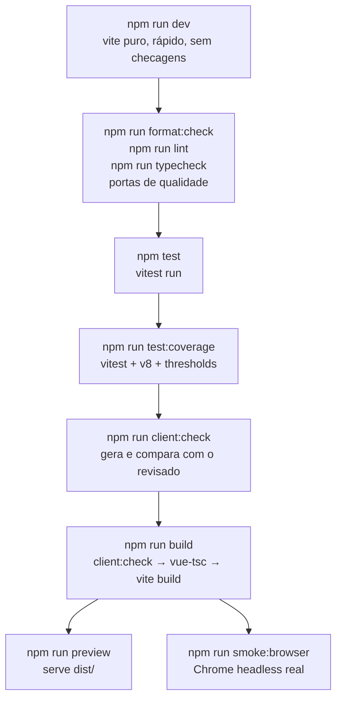

# 02 — Comandos (scripts do `package.json`)

Todos os scripts reais do `package.json`, o que cada um faz por dentro, quando usar e o que esperar na saída. Nenhum script é apelido vazio: cada seção mostra a cadeia que ele dispara.

## `npm run dev` → `vite`

Sobe o servidor de desenvolvimento do Vite com recarregamento quente. Não roda typecheck, lint nem verificação de contrato — velocidade é o objetivo. Use durante todo o desenvolvimento diário. Saída esperada: o endereço local (padrão `http://localhost:5173`) e confirmação de pronto em poucas centenas de milissegundos.

## `npm run build` → `client:check` + `vue-tsc --noEmit` + `vite build`

É a porta de entrega: só passa o código que está íntegro nas três camadas. A ordem é proposital — cada etapa só roda se a anterior passou:

1. `npm run client:check` — confirma que o cliente gerado corresponde ao contrato pinado.
2. `vue-tsc --noEmit` — verificação de tipos de TypeScript e dos blocos de script dos `.vue`, sem emitir arquivos.
3. `vite build` — empacotamento para `dist/`.

Use antes de qualquer entrega, e é o que o `Dockerfile` e o CI executam. Saída esperada: as três etapas sem erro e a pasta `dist/` com `index.html` e os recursos em `assets/`. Se o contrato estiver ausente ou o código gerado divergir, o build para na primeira etapa, antes de compilar qualquer coisa.

## `npm run client:generate` → `node scripts/generate-client.mjs`

Regenera o cliente API a partir do contrato aprovado em `openapi/openapi.json` usando o Orval `8.39.0` com a configuração de `orval.config.ts`. Por dentro, o script primeiro bloqueia a geração se o contrato aprovado estiver ausente, depois valida o pacote localmente e só então invoca o Orval, que escreve em `src/lib/api/generated/` em modo de separação por etiqueta. Use depois de receber um contrato novo aprovado. Saída esperada: os arquivos gerados atualizados sob `src/lib/api/generated/`; se o contrato estiver ausente, erro explícito de geração bloqueada e saída diferente de zero.

## `npm run client:check` → `client:generate` + `check-client-generated.mjs`

Executa a geração e depois compara o resultado com os arquivos gerados que estão revisados no git. Detecta divergência tanto em arquivos rastreados modificados (`git diff --exit-code`) quanto em arquivos novos não rastreados (`git ls-files --others`). Use em revisão de PR e antes do build para provar que ninguém editou o gerado à mão nem esqueceu de regenerar. Saída esperada: silêncio e saída zero quando tudo coincide; mensagem de divergência do cliente gerado quando há diferença.

## `npm test` → `vitest run`

Roda a suíte inteira uma vez, em modo não interativo, com ambiente `jsdom` e servidor MSW registrado pelo `src/test/setup.ts` (que aponta `VITE_API_URL` para a origem local de teste). Use a cada mudança de comportamento. Saída esperada: lista de arquivos de teste com contagem de testes aprovados, algo como dezenas de arquivos e centenas de testes verdes, com resumo final de duração.

## `npm run test:coverage` → `vitest run --coverage`

Igual ao `test`, mas coleta cobertura pelo provedor v8 sobre `src/**/*.ts` e `src/**/*.vue`, excluindo o código gerado pelo Orval, os utilitários de teste e os próprios arquivos de teste. Aplica os limiares mínimos: 87% de linhas, 83% de funções, 80% de ramos e 87% de instruções. Use antes de abrir PR — é o que o CI cobra. Saída esperada: tabela de cobertura por arquivo mais o resumo total; se qualquer limiar ficar abaixo, o comando falha mesmo com todos os testes verdes.

## `npm run typecheck` → `vue-tsc --noEmit`

Verifica os tipos de todo o projeto, incluindo os blocos de script dos componentes `.vue`, sem gerar saída. O TypeScript roda em modo estrito com rejeição de variáveis não utilizadas e acesso indexado verificado. Use depois de refatorações e antes de commitar mudanças de tipos. Saída esperada: nenhuma saída e saída zero quando está tudo certo; lista de erros com arquivo e linha quando há problema de tipo.

## `npm run lint` → `eslint .`

Aplica o ESLint com configuração flat sobre o repositório: regras recomendadas de JavaScript, TypeScript e Vue, mais proibições específicas como `v-html` e `v-if` junto com `v-for` no mesmo elemento. Use junto com o typecheck antes de commitar. Saída esperada: silêncio quando limpo; lista de problemas com arquivo, linha e nome da regra quando há violação.

## `npm run format` → `prettier --write ...`

Reescreve os arquivos para o padrão do Prettier: fontes em `src`, scripts, `package.json`, `tsconfig.json`, `vite.config.ts`, `eslint.config.ts`, `orval.config.ts` e `index.html`. O Prettier é a autoridade de formatação — discussão de estilo termina aqui. Use quando o `format:check` apontar divergência. Saída esperada: lista dos arquivos reescritos.

## `npm run format:check` → `prettier --check ...`

Apenas verifica a formatação, sem reescrever — é a versão que o CI usa. Use como primeira checagem rápida antes de commitar. Saída esperada: mensagem de que todos os arquivos estão conformes; em caso de divergência, a lista dos arquivos fora do padrão.

## `npm run preview` → `vite preview`

Serve localmente o `dist/` já empacotado, para validar o build de produção fora do dev server. Não recompila: exige um `npm run build` prévio. Use para conferir o artefato final antes de entregar ou depurar algo que só aparece no bundle. Saída esperada: endereço local servindo o `index.html` empacotado.

## `npm run smoke:browser` → `node scripts/smoke-browser.mjs`

Abre a aplicação em um Chrome headless real via protocolo de depuração, carrega a página e observa o tráfego de rede: qualquer pedido para origem diferente da aplicação é registrado como vazamento externo. Variáveis que ajustam o comportamento: `BROWSER_SMOKE_URL` (endereço da app, padrão `http://127.0.0.1:5173`), `CHROME_BIN` e `CHROME_REMOTE_ENDPOINT` para reaproveitar um Chrome remoto. Use depois do build ou do preview para provar que a SPA não fala com fontes, CDNs ou telemetrias externas — as fontes são empacotadas localmente justamente para este teste passar. Saída esperada: aprovação sem pedidos externos; a lista de URLs externas quando houver vazamento.

## `npm run contract:verify` → `python3 scripts/verify_contract.py`

Valida o contrato pinado em `openapi/` localmente, sem rede: confere o pin registrado em `contract-pin.json` contra o artefato e o recibo recebidos. É executado automaticamente dentro do `client:generate`, mas pode ser rodado sozinho para diagnosticar problemas de contrato. Use quando a geração falhar ou ao receber um pacote de contrato novo. Saída esperada: confirmação de verificação; erro explícito se o artefato ou o recibo divergirem do pin.

## Problemas comuns

- `npm ci` rejeita a versão do npm/node → alinhe com `npm install --global npm@12.2.0` e Node 24.15+.
- `InvalidEnvironmentConfigError: preview environment must never point to production API` → `VITE_APP_ENV` e `VITE_API_URL` inconsistentes.
- `client:generate` bloqueia com "Contrato aprovado ausente" → o artefato `openapi/` precisa estar commitado e passar em `npm run contract:verify`.
- `Client Orval gerado diverge dos arquivos revisados e pinados` → regenere com `npm run client:generate`; se persistir, o diff é real e precisa de review — não edite a mão.
- Login falha com 419 → origem da SPA ausente em `SANCTUM_STATEFUL_DOMAINS` / CORS da API.
