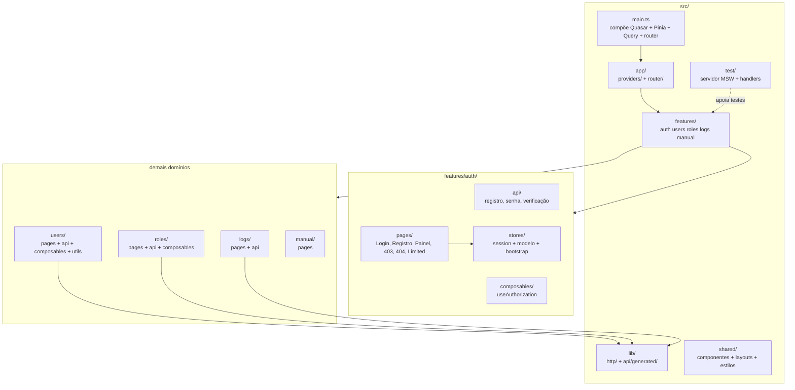
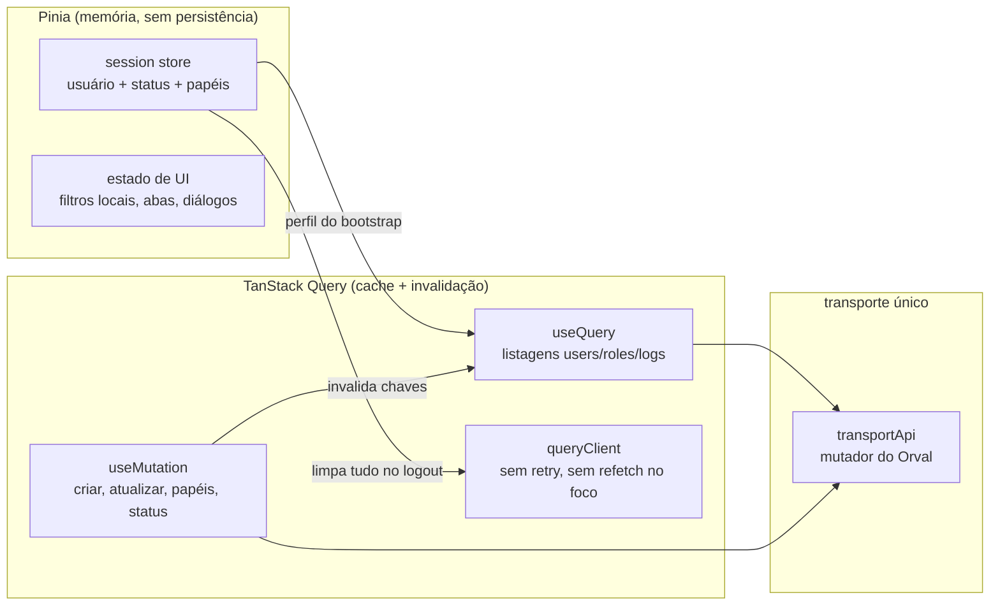
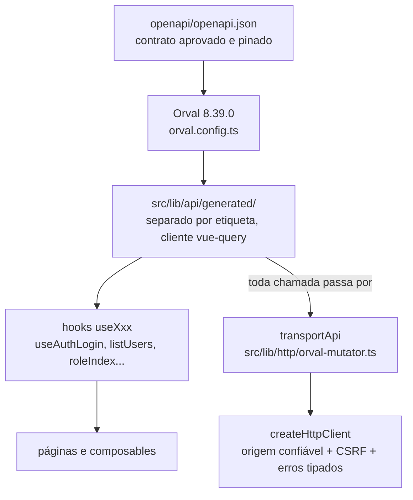
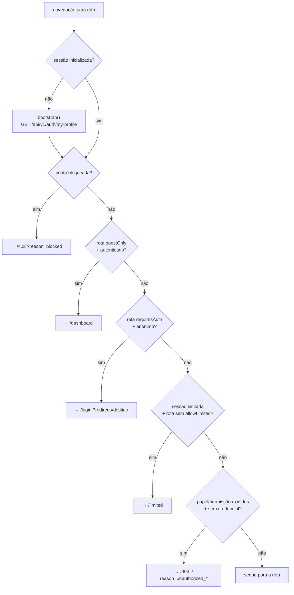
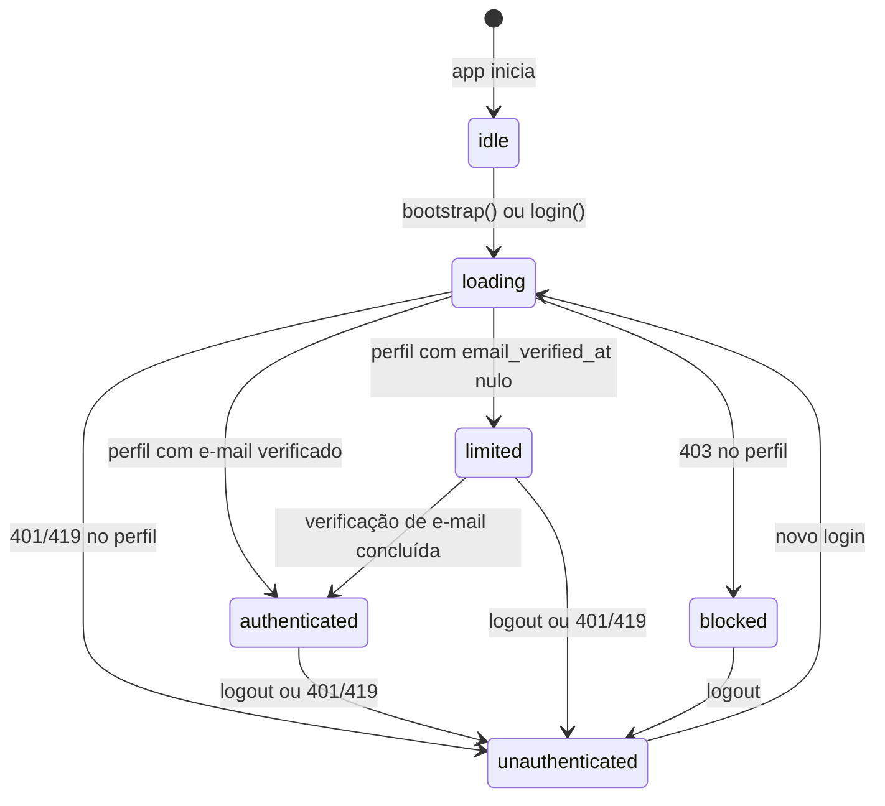

# 03 — Arquitetura

Expansão do `architecture.md`: como as pastas se organizam por domínio, como os dois gestores de estado dividem o trabalho, como o código gerado chega até as telas, como o router protege cada rota e quais estados uma sessão pode assumir.

## Mapa das pastas por funcionalidade

Cada funcionalidade é dona do seu pedaço: páginas, chamadas de API, composables e testes moram lado a lado. `users` tem ainda `utils` (como máscara de CPF) e `roles` e `users` expõem composables de listagem. `logs` é somente leitura de auditoria. `manual` é conteúdo interno sem camada de API. O `auth` é o único com `stores`, porque a sessão é transversal a todos os domínios.

## Ciclo Pinia vs TanStack Query

A regra central: estado de interface e de sessão fica no Pinia; estado de servidor fica no TanStack Query. Nunca se duplica resposta da API em store manual.

O ciclo de uma listagem, por exemplo a de usuários: o composable `useUsersList` declara filtros reativos locais e uma `useQuery` cuja chave inclui esses filtros; a função de busca chama o gerado do Orval, que passa pelo mutador e pelo cliente HTTP. Uma mutação (atualizar usuário, atribuir papéis) invalida a chave da listagem, e a Query refaz a busca sozinha. O `queryClient` partilhado desliga repetição automática e refetch ao focar a janela, para que a SPA nunca dispare tráfego que o usuário não pediu. No logout, a sessão limpa o usuário em memória e esvazia a cache da Query de uma vez.

## Do contrato ao componente: o mutador Orval

Todo o código sob `generated/` é propriedade do Orval e nunca é editado à mão — o cabeçalho de cada arquivo diz isso e o `client:check` prova. A configuração fixa a entrada no contrato pinado, a saída separada por etiqueta, o cliente `vue-query` sobre axios e o mutador `transportApi`, com sinal de aborto e versão 5 das queries. O mutador captura a origem confiável da API de forma imutável na criação e, a cada pedido, verifica se o `baseURL` continua sendo a raiz validada antes de enviar qualquer byte — qualquer tentativa de destino estrangeiro vira erro sem tráfego.

## Guards do router e tabela de rotas

O guard global corre antes de cada navegação. Se a sessão ainda não foi inicializada, ele faz o bootstrap primeiro (perfil via API) e só depois decide. Sessão bloqueada vai para `/403` com motivo de bloqueio, seja qual for o destino.

Tabela completa das rotas e o que cada proteção faz na prática:

| Rota | Nome | Exige login | convidado-somente | Permissão | allowLimited | Anônimo cai em | Sem credencial cai em |
|---|---|---|---|---|---|---|---|
| `/` | public-home | não | não | — | — | abre direto | abre direto |
| `/login` | login | não | sim | — | — | abre direto | autenticado vai ao painel |
| `/register` | register | não | sim | — | — | abre direto | autenticado vai ao painel |
| `/forgot-password` | forgot-password | não | sim | — | — | abre direto | autenticado vai ao painel |
| `/reset-password` | reset-password | não | sim | — | — | abre direto | autenticado vai ao painel |
| `/verify-email` | verify-email | não | não | — | — | abre direto | abre direto |
| `/dashboard` | dashboard | sim | não | — | não | `/login` com `redirect` | — |
| `/users` | users | sim | não | `users.view` | não | `/login` com `redirect` | `/403` |
| `/roles` | roles | sim | não | `roles.view` | não | `/login` com `redirect` | `/403` |
| `/logs` | logs | sim | não | `logs.view` | não | `/login` com `redirect` | `/403` |
| `/manual` | manual | sim | não | — | sim | `/login` com `redirect` | abre (limitada entra) |
| `/limited` | limited | sim | não | — | sim | `/login` com `redirect` | abre (limitada entra) |
| `/403` | forbidden | não | não | — | — | abre direto | abre direto |
| `/404` | not-found | não | não | — | — | abre direto | abre direto |
| `/:pathMatch(.*)*` | catch-all | não | não | — | — | página 404 | página 404 |

Sobre 401 e 403 vindos da rede (não do guard): respostas 401 e 419 disparam o evento de sessão expirada, que limpa a sessão em memória sem repetir a mutação que falhou — o 419 ainda reinicia o bootstrap CSRF antes de devolver o erro tipado. Já um 403 de API vira `HttpError` de proibido na tela correspondente, com mensagem fixa segura.

## Estados da sessão, incluindo a limitada

Os seis estados e o que cada um libera:

- `idle` — estado inicial, antes de qualquer bootstrap. O guard nunca decide sobre ele: primeiro inicializa.
- `loading` — bootstrap ou login em voo. Pedidos concorrentes de bootstrap partilham a mesma promessa em vez de disparar buscas repetidas, e gerações invalidadas (logout no meio do voo) são descartadas.
- `authenticated` — perfil carregado com e-mail verificado. Acesso total conforme papéis e permissões.
- `limited` — conta com `email_verified_at` nulo. Derivado tanto do status quanto do próprio perfil, então continua valendo mesmo se o status for recarregado. Só alcança rotas marcadas com `allowLimited` (`/manual` e `/limited`); qualquer outra rota autenticada redireciona para `/limited`, onde há ação de reenvio do e-mail de verificação.
- `blocked` — a API respondeu proibido ao perfil. Toda navegação cai em `/403` com motivo de bloqueio.
- `unauthenticated` — sem sessão. Rotas protegidas redirecionam ao login preservando o destino em `redirect`.

Nada da sessão é persistido no navegador: recarregar a página volta a `idle` e o bootstrap reconsulta o perfil. Não há token em `localStorage` nem snapshot de perfil em disco — a única fonte de verdade é a sessão cookie da API.
