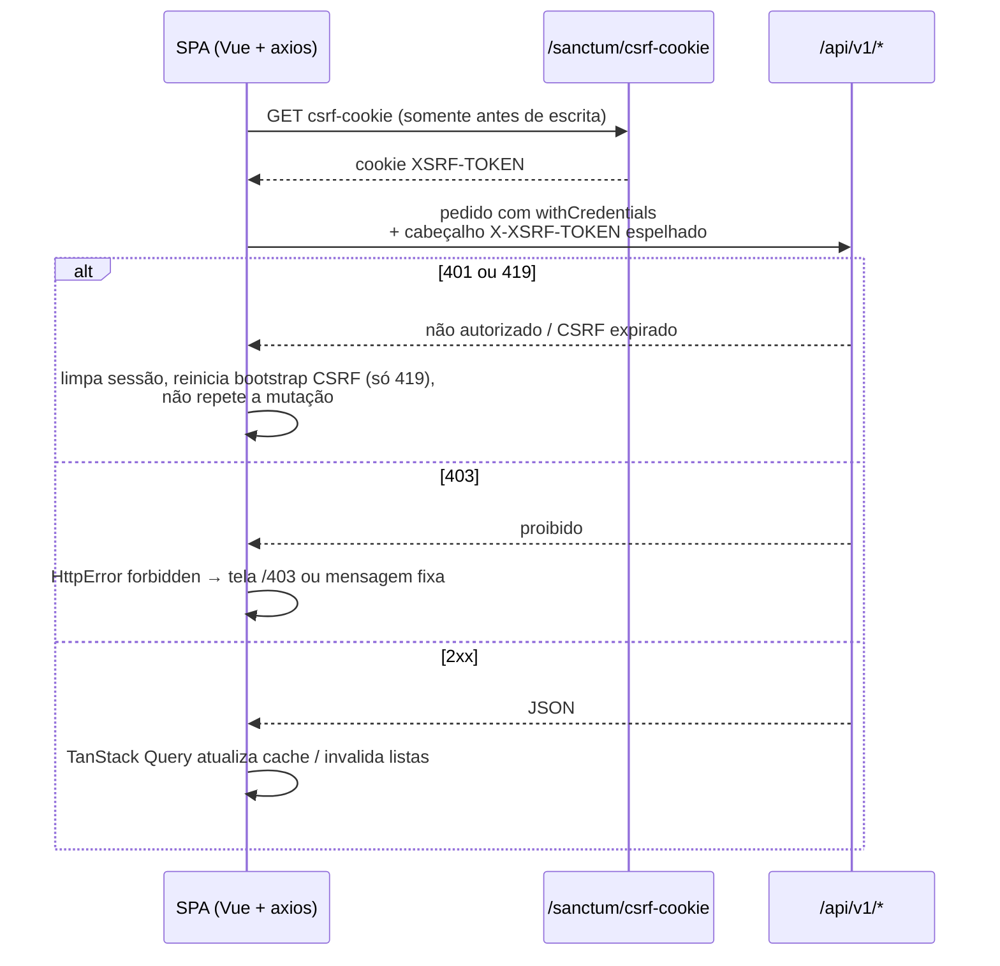
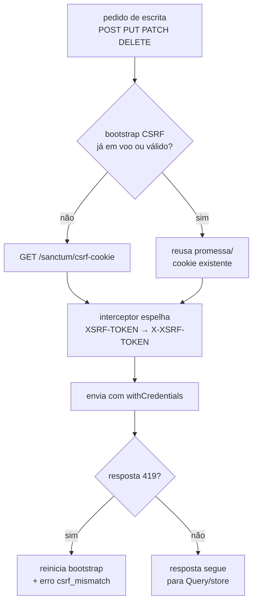
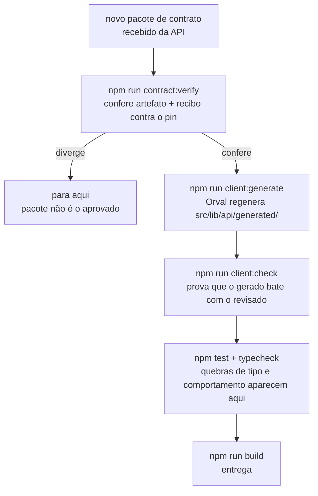

# 🔗 Integração fullstack (SPA ↔ API)

Como a SPA conversa com a API Laravel: a sequência de uma operação autenticada, o que muda por ambiente, como sessão e CSRF viajam e o que fazer quando o contrato muda. A tabela de endpoints no fim mostra cada chamada consumida e qual guard a protege.

---

## 📑 Índice

1. [Sequência SPA → API](#-sequência-spa--api)
2. [`VITE_API_URL` por ambiente](#-vite_api_url-por-ambiente)
3. [`withCredentials` + `csrf-cookie`](#-withcredentials--csrf-cookie)
4. [Domínio compartilhado e HTTPS](#-domínio-compartilhado-e-https)
5. [Quando o contrato OpenAPI muda](#-quando-o-contrato-openapi-muda)
6. [Endpoints consumidos e guards](#-endpoints-consumidos-e-guards)

---

## 🔁 Sequência SPA → API

Pontos que o diagrama resume: o bootstrap CSRF acontece somente antes de pedidos de escrita (`POST`, `PUT`, `PATCH`, `DELETE`), escritas concorrentes partilham a mesma promessa em voo, e leituras (`GET`) nunca disparam bootstrap. O cliente usa timeout de 15 segundos e `Accept: application/json` em tudo.

---

## 🌍 `VITE_API_URL` por ambiente

| Ambiente (`VITE_APP_ENV`) | Exemplo | `VITE_API_URL` | Regra |
|---|---|---|---|
| development | `.env.development.example` | `http://localhost:8000` | SPA em `:5173`, API em `:8000`, outra origem com CORS + Sanctum stateful |
| preview | `.env.preview.example` | `https://staging-api.starterkit.com` | Antevisões de PR; proibido apontar para produção (validado em código) |
| staging | `.env.staging.example` | `https://staging-api.starterkit.com` | QA e validação pré-lançamento |
| production | `.env.production.example` | `https://api.starterkit.com` | Release; valor vem de segredo de deploy, nunca de arquivo local |

> A validação da URL é falha fechada: exige `http`/`https` com autoridade real e rejeita barra invertida, caractere de controle, credencial embutida, query e fragmento. Em produção, a URL é selada no momento do build via `ARG VITE_API_URL` do `Dockerfile` — trocar a API de um deploy exige reconstruir a imagem, porque o valor vai embutido no bundle.

---

## 🍪 `withCredentials` + `csrf-cookie`

A sessão viaja em cookie HttpOnly propriedade da API — a SPA nunca toca no valor, só pede ao navegador que o envie com `withCredentials: true` em todas as instâncias do cliente central. Nenhum outro módulo pode criar axios próprio, então não existe caminho que esqueça a credencial.

O fluxo CSRF tem duas pernas:

1. `GET /sanctum/csrf-cookie` define o cookie `XSRF-TOKEN` no navegador.
2. O interceptor do cliente espelha esse cookie no cabeçalho `X-XSRF-TOKEN` de cada pedido de escrita.

Se a API responder 419 no meio de uma escrita, o coordenador CSRF reinicia o estado antes de devolver o erro tipado, então a próxima escrita refaz o bootstrap do zero em vez de repetir um cookie morto.

---

## 🔒 Domínio compartilhado e HTTPS

O cookie de sessão da API usa `SameSite=Lax` (padrão) e só viaja entre subdomínios do mesmo domínio registrável — e apenas se a API emitir o cookie com escopo de domínio pai (`SESSION_DOMAIN=.exemplo.com`). Se `SESSION_DOMAIN` for nulo ou omitido, o Laravel emite o cookie como *Host-Only* (`api.exemplo.com`): ele acompanha as requisições à API, mas o JavaScript da SPA em `app.exemplo.com` não o enxerga em `document.cookie` (o que afeta a leitura do `XSRF-TOKEN` para espelhar no `X-XSRF-TOKEN`). Na prática: SPA e API sob o mesmo domínio, em subdomínios distintos — `app.exemplo.com` + `api.exemplo.com` funciona; `app.exemplo.com` + `api.exemplo.net` não funciona, e nenhuma configuração de frontend contorna isso.

Pontos de atenção:

- **HTTPS em produção** — a API emite o cookie com `Secure`: a SPA também precisa ser servida em HTTPS. Página em HTTP é contexto não seguro: o navegador não envia o cookie de volta e o JavaScript sequer enxerga o `XSRF-TOKEN` com `Secure`, então a primeira escrita falha com 419 por falta do espelho no `X-XSRF-TOKEN`.
- **`SameSite=None`** — não é o padrão e só se cogita com `Secure` ativo e domínio compartilhado real. Não adote como correção de 419: se o 419 acontece, a causa é host/domínio fora de alinhamento ou sessão/CSRF ausente, não a flag.
- **Valores concretos** — `SESSION_DOMAIN`, `SANCTUM_STATEFUL_DOMAINS` e `CORS_ALLOWED_ORIGINS` vivem nas variáveis da API (documentadas lá). Atenção aos formatos: `CORS_ALLOWED_ORIGINS` exige esquema completo (`https://app.exemplo.com`); `SANCTUM_STATEFUL_DOMAINS` aceita só host/porta, sem esquema (`app.exemplo.com`). Inverter os formatos é causa comum de 419 em deploy. Antes de subir o ambiente, confirme que SPA e API apontam para subdomínios do domínio definido nelas.
- **`VITE_API_URL` de produção** — vem de segredo de deploy e deve apontar para o host HTTPS da API, nunca para `localhost` nem para HTTP.

> Se o 419 persistir com `withCredentials` e CSRF corretos, verifique o alinhamento de domínio antes de qualquer ajuste no código.

---

## 📄 Quando o contrato OpenAPI muda

O contrato é publicado pela API e pinado neste repositório: `openapi/openapi.json` é o snapshot aprovado, acompanhado do pin verificável (origem, commit, execução, resumo criptográfico) e do recibo do pacote. A SPA nunca consome a API fora do contrato aprovado. O procedimento quando chega um contrato novo:

Na prática: receba o pacote oficial, rode a verificação, regenere o cliente, confira a divergência e deixe testes e typecheck acusarem campos renomeados ou endpoints removidos. Se o `client:check` falhar sem você ter regenerado, alguém editou o gerado à mão ou esqueceu de versionar a regeneração — nunca ajuste o gerado diretamente.

---

## 📡 Endpoints consumidos e guards

Métodos e caminhos abaixo são os que o cliente gerado efetivamente chama (prefixo `/api/v1` mais a raiz do CSRF). A coluna de guard indica a proteção de rota correspondente na SPA:

| Método | Caminho | Uso na SPA | Guard de rota |
|---|---|---|---|
| `GET` | `/api/v1` | raiz versionada da API | — (diagnóstico) |
| `GET` | `/api/v1/health` | saúde da API | — (diagnóstico) |
| `GET` | `/sanctum/csrf-cookie` | bootstrap CSRF antes de escritas | — (transporte) |
| `POST` | `/api/v1/register` | criar conta (página de registro) | `guestOnly` em `/register` |
| `POST` | `/api/v1/login` | login, depois recarrega o perfil | `guestOnly` em `/login` |
| `POST` | `/api/v1/logout` | logout, limpa sessão e cache da Query | — (ação autenticada) |
| `GET` | `/api/v1/auth/my-profile` | bootstrap da sessão e perfil | base de `requiresAuth` |
| `POST` | `/api/v1/forgot-password` | solicitar redefinição (mensagem neutra) | `guestOnly` em `/forgot-password` |
| `POST` | `/api/v1/reset-password` | redefinir com token + confirmação | `guestOnly` em `/reset-password` |
| `POST` | `/api/v1/email/verification-notification` | reenviar e-mail de verificação | página `/limited` (`allowLimited`) |
| `GET` | `/api/v1/email/verify/{id}/{hash}` | confirmar e-mail pelo link | rota aberta `/verify-email` |
| `GET` | `/api/v1/users` | listagem paginada com filtros | `requiresAuth` + `users.view` em `/users` |
| `GET` | `/api/v1/users/{user}` | detalhe do usuário | `requiresAuth` + `users.view` |
| `PATCH` | `/api/v1/users/{user}` | atualizar usuário | `requiresAuth` + `users.view` |
| `POST` | `/api/v1/users/{user}/status` | bloquear/desbloquear conta | `requiresAuth` + `users.view` |
| `PUT` | `/api/v1/users/{user}/roles` | atribuir papéis | `requiresAuth` + `users.view` |
| `GET` | `/api/v1/roles` | listagem de papéis | `requiresAuth` + `roles.view` em `/roles` |
| `PUT` | `/api/v1/roles/{role}/permissions` | atualizar permissões do papel | `requiresAuth` + `roles.view` |
| `GET` | `/api/v1/activity-log` | auditoria de atividade | `requiresAuth` + `logs.view` em `/logs` |

> Sem a permissão da coluna, o guard manda para `/403`; sem sessão, para `/login` com `redirect`; com sessão limitada, tudo que não tem `allowLimited` manda para `/limited`. Erros vindos da rede seguem o mapeamento tipado: 401 e 419 limpam a sessão, 403 vira proibido, 422 carrega erros por campo, 429 informa os segundos de espera.
