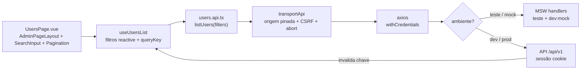
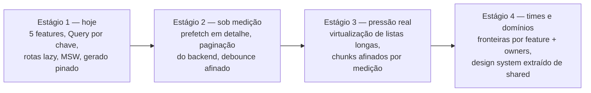

# 🏗️ Arquitetura do código e escala sem reescrita

Como uma fatia atravessa o código e como o frontend cresce por estágios —
**nível de código, não infraestrutura**. Pastas, Query vs Pinia, guards e sessão
estão em [03-arquitetura](03-arquitetura.md); vereditos, em
[06-padroes](06-padroes.md).

## 📑 Índice

1. [Travessia de uma fatia](#-travessia-de-uma-fatia)
2. [Escala em estágios: o que muda no código](#-escala-em-estágios-o-que-muda-no-código)

---

## 🔀 Travessia de uma fatia

O caminho de um clique numa página de listagem até a API — e onde o mock entra:

Regras do desenho: página nunca chama HTTP direto; composable nunca monta URL;
`api/*.api.ts` nunca importa store; mock troca o fio, nunca o código.

## 📈 Escala em estágios: o que muda no código

| Item | Corte quando medir dor | Como medir |
| --- | --- | --- |
| Navegação lista→detalhe | prefetch da query de detalhe no hover/intent | tempo lista→detalhe, requests duplicados |
| Páginas profundas | paginação do backend (cursor quando a API oferecer) em vez de page crescente | p95 em páginas fundas, payload |
| Listas longas | virtualização (só a viewport renderiza) | FPS/scroll, nós DOM, memória |
| Bundle | code-split já existe por rota; extrair chunk de vendor/feature sob medição | tamanho do chunk inicial, Lighthouse |
| Cache Query | `staleTime`/`gcTime` por domínio (lista muda devagar ≠ sessão); nunca persistir servidor em disco | taxa de refetch, tráfego repetido |
| Mocks | cenários por feature em arquivos próprios quando `mock-handlers.ts` inchar | tempo de suíte, conflitos de handler |
| `shared` | vira design system versionado só com 2+ consumidores externos ou time dedicado | usos por componente, donos |

O que **não muda** em nenhum estágio: gerado intocável com `client:check`,
servidor só na Query, sessão só em memória, guards espelhando o backend sem
substituí-lo, mensagens pelo dicionário. Cada transição é um PR próprio com
medição antes/depois.
