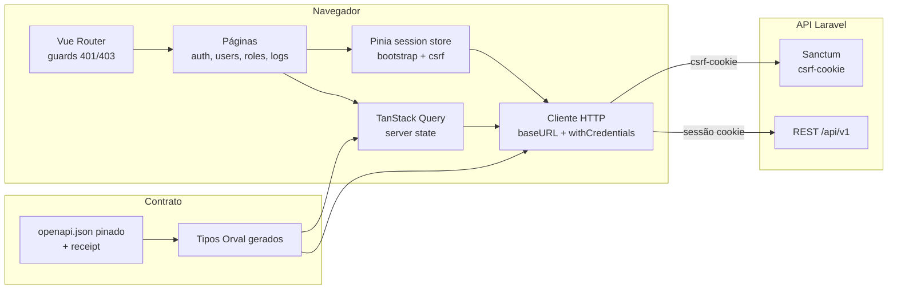

# Arquitetura do frontend

Fluxo de autenticação: `GET /sanctum/csrf-cookie` → `POST /api/v1/login` →
`bootstrap()` (`GET /api/v1/my-profile`) → guards liberam rotas por
`permissions`. Sessão limitada (`email_verified_at: null`) só acessa
logout, perfil mínimo e verificação.
